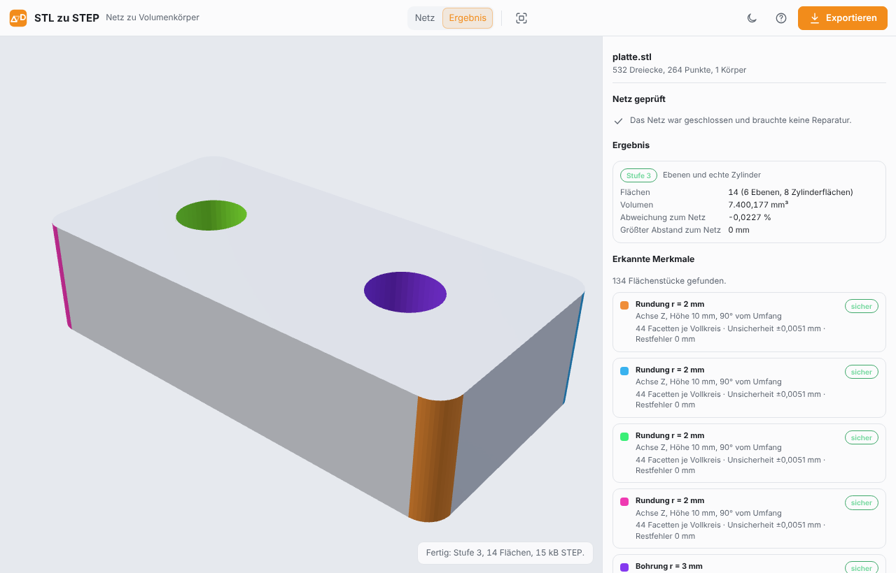

# STL zu STEP

Ein **STL** ist ein Dreiecksnetz: tausende Facetten, keine Bohrungen, keine Radien, keine Maße. Wer ein Modell von
Thingiverse oder Printables in **Fusion 360** oder **FreeCAD** öffnet, kann es kaum ändern – eine Bohrung verschieben
geht nicht, weil es keine Bohrung gibt, nur Dreiecke.

Dieses Werkzeug macht aus dem Netz (STL, OBJ oder 3MF) einen **STEP-Volumenkörper** und erkennt dabei **Ebenen und Zylinder**: Aus den
Facetten einer Bohrung wird wieder eine Bohrung, aus einer Rundung wieder eine Rundung. Kaputte Netze werden vorher
geheilt, und **jede Reparatur, jedes verworfene Merkmal und jeder Rückfall steht mit Zahl im Bericht**. Alles läuft im
Browser – die Datei verlässt den Rechner nicht.



**Online:** <https://flog93.github.io/3D-Druck/STL-zu-STEP/> – Teil der [3D-Druck-Werkzeuge](../README.md).

## In drei Schritten

1. **STL-, OBJ- oder 3MF-Datei ablegen** (ziehen oder auswählen).
2. **Bericht lesen:** Was wurde repariert? Welche Stufe kam heraus? Welche Zylinder wurden erkannt?
3. **Exportieren** – die `.step`-Datei öffnet jedes CAD-Programm.

## Die drei Stufen

Das Werkzeug nimmt immer die höchste Stufe, die seine eigene Prüfung besteht, und fällt sonst zurück. Jeder Rückfall
steht mit Grund im Bericht.

| Stufe | Was herauskommt | Wann |
| --- | --- | --- |
| **3** | Ebenen und **echte Zylinderflächen** mit Kreisbögen als Kanten | Normalfall: Bohrungen und Rundungen wurden sicher erkannt |
| **2** | Ebene Flächen verschmolzen (mit Löchern), Gekrümmtes bleibt facettiert | Kein Zylinder sicher erkannt (Kugel, Torus, Freiform) oder Erkennung abgeschaltet |
| **1** | Jedes Dreieck eine eigene Fläche | Notnagel: immer möglich, aber groß und in CAD langsam |
| **offen** | Offene Schale statt Körper | Das Netz ließ sich nicht schließen (z. B. ein Loch mit mehr als 64 Kanten) – immer mit Warnung |

Beispiel `tests/fixtures/platte.stl` (Platte 40 × 20 × 10 mit vier Rundungen und zwei Bohrungen, 532 Dreiecke):

| Stufe | Flächen | STEP-Größe | Volumen (exakt: 7400,177 mm³) |
| --- | --- | --- | --- |
| 1 | 532 | 372 kB | 7401,857 (= Netz) |
| 2 | 134 | 97 kB | 7401,857 (= Netz) |
| **3** | **14** | **16 kB** | **7400,177** |

## 3MF-Dateien

Eine 3MF-Datei ist die Druckdatei der Slicer (Bambu Studio, PrusaSlicer, Cura, Fusion 360). Das Werkzeug liest die
**Bauliste** mit allen Bauteilen, rechnet **Einheit** und **Transformationen** ein (verschoben, gedreht, skaliert,
gespiegelt, verschachtelte Komponenten, Teile in eigenen Modelldateien) und macht aus jedem Körper einen
Volumenkörper. Im Bericht steht eine **Analyse der Datei**: Programm, Einheit, jedes Objekt mit Größe und Volumen,
Instanzen, Platte und Spiegelung.

**Nicht übernommen** wird, was nicht zum Bauteil gehört – jedes mit Grund im Bericht: Stützstrukturen und Hilfskörper
(Objekttyp), als „nicht druckbar“ markierte Teile sowie bei Bambu Studio und PrusaSlicer Modifizierer, Stützen-Sperren
und **Negativteile** (ein Negativteil wird *nicht* vom Körper abgezogen). Farben und Materialien werden nicht gelesen,
ebenso wenig Gitterstäbe und Schichtdaten.

> **Gemessen an selbst gebauten Dateien**, die auch `lib3mf` (die Referenzbibliothek) liest. Die Layouts von Bambu
> Studio und PrusaSlicer folgen der Beschreibung der Formate; an echten Slicer-Dateien ist das noch nicht geprüft.

## Was erkannt wird

- **Zylinder** (Bohrungen, Rundungen, Zapfen) mit Achse, Radius, Höhe und Vertrauen. Ab **12 Facetten** je Vollkreis
  gilt die Erkennung als sicher; bei **8 bis 11** fragt das Werkzeug nach („Als Zylinder übernehmen“), denn ein Achteck
  kann ein grober Zylinder oder ein echtes Achteck sein. Unter 8 Facetten bleibt ein Sechseck ein Sechseck.
- **Ebenen**: zusammenhängende, wirklich ebene Flächenstücke werden zu einer Fläche verschmolzen, Löcher darin bleiben
  Löcher.
- **Nicht erkannt** werden in dieser Fassung Kugel, Kegel, Torus und Freiformflächen – sie bleiben facettiert (Stufe 2).
  Gegenprüfungen sorgen dafür, dass daraus **keine** Scheinzylinder werden.

## Was repariert wird

Vor der Erkennung wird das Netz geheilt, in dieser Reihenfolge, und alles davon steht mit Zahl im Bericht:

1. Dreiecke ohne Fläche und doppelte Dreiecke entfernen
2. T-Kreuzungen teilen (ein Punkt mitten auf der Kante eines Nachbarn)
3. Kanten mit mehr als zwei Dreiecken bereinigen
4. Umlaufrichtung je Körper vereinheitlichen
5. Löcher bis 64 Kanten füllen (größere bleiben offen und werden gemeldet)
6. Gesamtrichtung prüfen (ein komplett nach innen gedrehtes Netz wird umgedreht)
7. Mehrere Körper trennen – jeder wird ein eigener Volumenkörper in derselben Datei

Die Reparatur ist **gemessen, nicht geglaubt**: Vor und nach dem Heilen wird das Netz diagnostiziert (offene
Randkanten, Löcher, nicht-manifold Kanten und Berührungspunkte, falsch orientierte Nachbarn, entartete und doppelte
Dreiecke, nach innen orientiertes Volumen, getrennte Schalen), und danach prüft das Werkzeug, **wie weit die Reparatur
die Form verschoben hat**. Der Bericht zeigt „Vorher / Nachher“ und diese Abweichung; wird die Toleranz überschritten,
steht das als Warnung da – oder die Reparatur wird verworfen oder abgebrochen, je nach Einstellung. Ein **großes Loch**
(über 16 Kanten oder mehr als 5 % der Diagonale) wird mit „Warnung: großes Loch geschlossen“ gemeldet, denn die Füllung
ist nur eine Schätzung der Fläche. Der **Reparaturbericht** lässt sich im Export-Dialog als JSON herunterladen.

## Einstellungen

- **Einheit:** Millimeter, Zoll, Zentimeter, Meter oder ein eigener Faktor. STL kennt keine Einheit; ist das Teil
  verdächtig groß oder klein, warnt das Werkzeug. Eine 3MF-Datei bringt ihre Einheit mit; eine hier eingestellte gilt
  zusätzlich, und der Bericht sagt es.
- **Zylinder erkennen** (an): aus bleibt alles Ebene – nützlich, wenn die Erkennung bei einem Teil danebenliegt.
- **Unsichere übernehmen** (aus): nimmt auch Löcher mit 8 bis 11 Facetten als Zylinder.
- **Toleranz** (streng / Standard / grob): wie krumm ein Flächenstück noch als eine Ebene durchgeht. „grob“ ist für
  Scans und verrauschte Netze – es macht größere Flächen, dafür liegt das Ergebnis weiter vom Netz entfernt (der
  Bericht nennt den größten Abstand). An einem echten CAD-Modell gemessen: 7007 statt 11 801 Flächen bei 7,3·10⁻⁴ mm.
- **Radien auf 0,05 mm runden** (aus): rastet einen Radius auf einen runden Wert ein, aber nur innerhalb der
  gemessenen Unsicherheit.
- **Netzreparatur:** *Kleine Schalen entfernen* (aus) – lose, winzige Körper unter einer Dreieckszahl (Standard 10),
  jede entfernte Schale steht mit Größe im Bericht, die letzte Schale bleibt immer. *Größte erlaubte Abweichung*
  (1 % der Diagonale) und *Bei Überschreitung* (Reparatur behalten und warnen / verwerfen, dann bleiben Löcher offen /
  abbrechen). *Selbstüberschneidungen prüfen* (aus) – sucht Dreiecke, die sich durchdringen, etwa bei zwei
  überlappenden Körpern; gründlich, aber langsam, ab 200 000 Dreiecken übersprungen. Selbstüberschneidungen werden
  **gemeldet, nicht repariert**.

## Grenzen

- Aus einem **unterteilten Netz** kommt der Radius etwas zu klein heraus (gemessen −0,18 %): Die Punkte liegen auf den
  Sehnen, nicht auf dem Kreis. Der Bericht nennt die Unsicherheit, „Radien runden“ hilft bei Normmaßen.
- **Kugel, Kegel, Torus, Freiform** bleiben Facetten (Stufe 2).
- **Dauer** (gemessen): 20 000 Dreiecke ≈ 2 s, 100 000 ≈ 2–5 s (je nach Teil), 225 000 ≈ 35 s. Ab 500 000 Dreiecken fragt das
  Werkzeug vorher nach; die Umwandlung läuft im Hintergrund und lässt sich mit „Zurück“ (oben links, Taste Esc) abbrechen; das führt zum Startbildschirm.
- **Dateigröße:** Bleibt ein Teil facettiert (Stufe 1 oder 2), wird die STEP-Datei groß – für ein Modell mit 225 000
  Dreiecken rund 200 MB. Das ist die ehrliche Folge von „jede Facette eine Fläche“.
- **Echte Dateien:** Sieben öffentliche Modelle (CAD-Klassiker, 3DBenchy, Stanford-Bunny, ein Drache mit 250 000
  Dreiecken) sind gemessen und haben fünf Fehler zutage gefördert, die inzwischen behoben und als Tests abgesichert
  sind – siehe [`docs/MACHBARKEIT.md`](docs/MACHBARKEIT.md) Abschnitt 7. Die Testsammlung selbst ist **synthetisch**
  (mit OpenCascade erzeugt); echte Druckteile mit Bohrungen von Thingiverse/Printables fehlen weiterhin
  ([`docs/PLAN.md`](docs/PLAN.md) Schritt 11).

## Für Entwickler

- [`docs/SPEC.md`](docs/SPEC.md) – was gebaut wird und warum, mit allen Schwellen
- [`docs/MACHBARKEIT.md`](docs/MACHBARKEIT.md) – die Messungen, auf denen alles beruht
- [`docs/PLAN.md`](docs/PLAN.md) – die Schritte der Umsetzung
- [`docs/referenz/`](docs/referenz/README.md) – die lauffähigen Python-Prototypen

```
js/core/     parse, weld, meshops, heal, patches, cylinders, constraints, topology, brep, verify, pipeline, linalg
js/export/   step.js (schreibt mit shared/js/step.js)
js/ui/       app, report, preview, export-dialog, help
js/worker.js Umwandlung im Hintergrund (Modul-Worker)
tests/       node --test, Fixtures mit Wahrheit (expected.json), Werkzeuge für OpenCascade und den Browser
```

Tests:

```bash
npm run test:stl                 # Unit-Tests (Node >= 22)
node STL-zu-STEP/tests/tools/measure.mjs <dateien…>   # echte Dateien durchmessen (Stufe, Dauer, Merkmale)
node STL-zu-STEP/tests/tools/repair-report.mjs <datei> [--json] [--step]   # Reparatur: Vorher/Nachher, Abweichung, Zeiten
python3 STL-zu-STEP/tests/tools/crosscheck_trimesh.py   # Diagnose und Reparatur gegen trimesh/pymeshfix prüfen
python3 STL-zu-STEP/tests/tools/crosscheck_3mf.py   # 3MF-Leser gegen lib3mf prüfen
node STL-zu-STEP/tests/tools/make_3mf_fixtures.mjs   # 3MF-Testdateien neu erzeugen
npm run validate:stl             # STEP aus allen Fixtures mit OpenCascade prüfen (pip install cadquery-ocp)
# Selbsttest der Oberfläche im echten Browser (Playwright außerhalb des Repos installieren):
PLAYWRIGHT=~/pw/node_modules/playwright node STL-zu-STEP/tests/tools/ui-selftest.mjs --screenshot docs/screenshot.png
```
